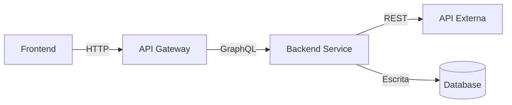

# Templates das Seções do TDD

Índice:

1. [Cabeçalho e Metadados](#1-cabeçalho-e-metadados-obrigatória)
2. [Contexto](#2-contexto-obrigatória)
3. [Definição do Problema e Motivação](#3-definição-do-problema-e-motivação-obrigatória)
4. [Escopo](#4-escopo-obrigatória)
5. [Solução Técnica](#5-solução-técnica-obrigatória)
6. [Riscos](#6-riscos-obrigatória)
7. [Plano de Implementação](#7-plano-de-implementação-obrigatória)
8. [Considerações de Segurança](#8-considerações-de-segurança-crítica)
9. [Estratégia de Testes](#9-estratégia-de-testes-crítica)
10. [Monitoramento e Observabilidade](#10-monitoramento-e-observabilidade-crítica)
11. [Plano de Rollback](#11-plano-de-rollback-crítica)
12. [Métricas de Sucesso](#12-métricas-de-sucesso-sugerida)
13. [Glossário e Termos de Domínio](#13-glossário-e-termos-de-domínio-sugerida)
14. [Alternativas Consideradas](#14-alternativas-consideradas-sugerida)
15. [Dependências](#15-dependências-sugerida)
16. [Requisitos de Performance](#16-requisitos-de-performance-sugerida)
17. [Plano de Migração](#17-plano-de-migração-sugerida)
18. [Questões em Aberto](#18-questões-em-aberto-sugerida)
19. [Roadmap / Cronograma](#19-roadmap--cronograma-sugerida)
20. [Aprovações e Sign-off](#20-aprovações-e-sign-off-sugerida)
21. [Changelog do Documento](#21-changelog-do-documento-recomendada)

---

## 1. Cabeçalho e Metadados (OBRIGATÓRIA)

```markdown
# TDD - [Nome do Projeto/Feature]

| Campo              | Valor                            |
| ------------------ | -------------------------------- |
| Tech Lead          | @Nome                            |
| Product Manager    | @Nome (se aplicável)             |
| Time               | Nome1, Nome2, Nome3              |
| Epic/Ticket        | [Link para Jira/Linear]          |
| Figma/Design       | [Link, se aplicável]             |
| Status             | Rascunho / Em Revisão / Aprovado |
| Criado em          | AAAA-MM-DD                       |
| Última Atualização | AAAA-MM-DD                       |
```

**Se o usuário não fornecer**: pergunte Tech Lead, membros do time e link da Epic.

---

## 2. Contexto (OBRIGATÓRIA)

```markdown
## Contexto

[Descrição do projeto em 2-4 parágrafos]

**Background**:
Qual o estado atual? A qual sistema/feature isto se relaciona?

**Domínio**:
De qual domínio de negócio isto faz parte? (ex.: billing, autenticação, entrega de conteúdo)

**Stakeholders**:
Quem se importa com este projeto? (usuários, negócio, compliance, etc.)
```

**Se não estiver claro**: pergunte "Você pode descrever a situação atual e a qual domínio de negócio isto se relaciona?"

---

## 3. Definição do Problema e Motivação (OBRIGATÓRIA)

```markdown
## Definição do Problema e Motivação

### Problemas que Estamos Resolvendo

- **Problema 1**: [Dor específica com impacto]
  - Impacto: [quantifique se possível — tempo perdido, custo, fricção para o usuário]
- **Problema 2**: [Outra dor]
  - Impacto: [quantifique se possível]

### Por Que Agora?

- [Driver de negócio — expansão de mercado, pressão de concorrentes, exigência regulatória]
- [Driver técnico — dívida técnica, limites de escalabilidade]
- [Driver de usuário — feedback de clientes, padrões de uso]

### Impacto de NÃO Resolver

- **Negócio**: [perda de receita, desvantagem competitiva]
- **Técnico**: [acúmulo de dívida técnica, degradação do sistema]
- **Usuários**: [experiência ruim, risco de churn]
```

**Se o usuário disser apenas "para integrar com X"**: pergunte "Quais problemas específicos essa integração resolve? Por que é importante agora? O que acontece se não fizermos?"

---

## 4. Escopo (OBRIGATÓRIA)

```markdown
## Escopo

### ✅ Dentro do Escopo (V1 - MVP)

Lista explícita do que SERÁ entregue:

- Feature/capacidade 1
- Feature/capacidade 2
- Feature/capacidade 3
- Ponto de integração A
- Migração de dados para X

### ❌ Fora do Escopo (V1)

Lista explícita do que NÃO será incluído nesta fase:

- Feature X (adiada para V2)
- Integração Y (não necessária para o MVP)
- Analytics avançado (melhoria futura)
- Suporte multi-região (V2)

### 🔮 Considerações Futuras (V2+)

O que pode vir depois:

- Feature A (depende da demanda dos usuários)
- Feature B (após validação da V1)
```

**Se o usuário não definir**: pergunte "Quais são os must-haves para a V1? O que pode esperar versões futuras?"

---

## 5. Solução Técnica (OBRIGATÓRIA)

````markdown
## Solução Técnica

### Visão Geral da Arquitetura

[Descrição de alto nível da solução]

**Componentes Principais**:

- Componente A: [responsabilidade]
- Componente B: [responsabilidade]
- Componente C: [responsabilidade]

**Diagrama de Arquitetura**:

[Inclua diagrama Mermaid, PlantUML ou link para o diagrama]



### Fluxo de Dados

1. **Passo 1**: Ação do usuário → Frontend
2. **Passo 2**: Frontend → API Gateway (POST /resource)
3. **Passo 3**: API Gateway → Camada de Serviço
4. **Passo 4**: Serviço → API Externa (se aplicável)
5. **Passo 5**: Serviço → Database (persistência)
6. **Passo 6**: Resposta → Frontend

### APIs e Endpoints

| Endpoint               | Método | Descrição       | Request     | Response         |
| ---------------------- | ------ | --------------- | ----------- | ---------------- |
| `/api/v1/resource`     | POST   | Cria recurso    | `CreateDto` | `ResourceDto`    |
| `/api/v1/resource/:id` | GET    | Busca por ID    | -           | `ResourceDto`    |
| `/api/v1/resource/:id` | DELETE | Remove recurso  | -           | `204 No Content` |

**Exemplo de Request/Response**:

```json
// POST /api/v1/resource
{
  "name": "Exemplo",
  "type": "standard"
}

// Response 201 Created
{
  "id": "550e8400-e29b-41d4-a716-446655440000",
  "name": "Exemplo",
  "type": "standard",
  "status": "active",
  "createdAt": "2026-02-04T10:00:00Z"
}
```

### Mudanças no Banco de Dados

**Novas Tabelas**:

- `{NomeModulo}{NomeEntidade}` - [descrição]
  - Campos principais: id, userId, name, status
  - Timestamps: createdAt, updatedAt
  - Índices: userId, status (para performance de consulta)

**Mudanças de Schema** (se modificar existente):

- Adicionar coluna `novoCampo` à tabela `TabelaExistente`
  - Tipo: [varchar/integer/jsonb/etc.]
  - Constraints: [nullable/unique/foreign key]

**Estratégia de Migration**:

- Gerar migration a partir das mudanças de schema
- Testar a migration em staging primeiro
- Executar em janela de baixo tráfego
- Ter a migration de rollback pronta

**Backfill de Dados** (se necessário):

- Registros afetados: estimar quantidade
- Tempo de processamento: estimar duração da migração de dados
- Validação: como verificar a integridade dos dados após o backfill
````

**Se a descrição for vaga**: pergunte "Quais são os componentes principais? Como os dados fluem pelo sistema? Quais APIs serão criadas/modificadas?"

---

## 6. Riscos (OBRIGATÓRIA)

```markdown
## Riscos

| Risco                        | Impacto | Probabilidade | Mitigação                                                                  |
| ---------------------------- | ------- | ------------- | --------------------------------------------------------------------------- |
| Indisponibilidade da API externa | Alto    | Média         | Implementar circuit breaker, cachear respostas, fallback para modo degradado |
| Falha na migração de dados   | Alto    | Baixa         | Testar em cópia de staging, executar dry-run, ter script de rollback pronto  |
| Degradação de performance    | Médio   | Média         | Load test antes do deploy, implementar cache, monitorar latência             |
| Vulnerabilidade de segurança | Alto    | Baixa         | Revisão de segurança, pentest, seguir diretrizes OWASP                       |
| Scope creep                  | Médio   | Alta          | Escopo bem definido, processo de change request, alinhamento recorrente      |

**Critérios de Pontuação**:

- **Impacto**: Alto (sistema fora do ar, perda de dados) / Médio (UX degradada) / Baixo (inconveniência menor)
- **Probabilidade**: Alta (>50%) / Média (20-50%) / Baixa (<20%)
```

**Se o usuário fornecer < 3 riscos**: pergunte "O que pode dar errado? Considere: dependências externas, integridade de dados, performance, segurança, mudanças de escopo."

---

## 7. Plano de Implementação (OBRIGATÓRIA)

```markdown
## Plano de Implementação

| Fase                  | Tarefa                | Descrição                                  | Responsável | Status | Estimativa |
| --------------------- | --------------------- | ------------------------------------------ | ----------- | ------ | ---------- |
| **Fase 1 - Setup**    | Configurar credenciais | Obter API keys, configurar ambiente        | @Dev1       | TODO   | 1d         |
|                       | Setup do banco        | Criar schema, configurar datasource        | @Dev1       | TODO   | 1d         |
| **Fase 2 - Core**     | Entidades e repos     | Criar entidades e repositórios             | @Dev2       | TODO   | 3d         |
|                       | Serviços              | Implementar serviços de lógica de negócio  | @Dev2       | TODO   | 4d         |
| **Fase 3 - APIs**     | Endpoints REST        | Criar controllers e DTOs                   | @Dev3       | TODO   | 3d         |
|                       | Integração            | Integrar com a API externa                 | @Dev1       | TODO   | 3d         |
| **Fase 4 - Testes**   | Testes unitários      | Testar serviços e repositórios             | @Time       | TODO   | 2d         |
|                       | Testes E2E            | Testar fluxo completo                      | @Time       | TODO   | 3d         |
| **Fase 5 - Deploy**   | Deploy em staging     | Deploy em staging, smoke test              | @DevOps     | TODO   | 1d         |
|                       | Deploy em produção    | Rollout faseado em produção                | @DevOps     | TODO   | 1d         |

**Estimativa Total**: ~20 dias (4 semanas)

**Dependências**:

- A Fase N deve ser concluída antes da Fase N+1
- Acesso à API externa necessário antes da Fase 3
- Revisão de segurança necessária antes da Fase 5
```

**Se o plano for vago**: pergunte "Você consegue quebrar isso em fases com tarefas específicas? Quem trabalhará em cada parte? Qual o cronograma estimado?"

---

## 8. Considerações de Segurança (CRÍTICA para pagamentos/auth/PII)

```markdown
## Considerações de Segurança

### Autenticação e Autorização

- **Autenticação**: como os usuários provam identidade
  - Exemplo: JWT, OAuth 2.0, sessão
- **Autorização**: o que usuários autenticados podem acessar
  - Exemplo: baseada em papéis (RBAC), baseada em atributos (ABAC)
  - Garantir que usuários só acessem seus próprios recursos

### Proteção de Dados

**Criptografia**:

- **At Rest**: criptografia de banco habilitada (AES-256)
- **In Transit**: TLS 1.3 em toda comunicação de API
- **Segredos**: armazenar API keys em variáveis de ambiente / gerenciador de segredos (AWS Secrets Manager, HashiCorp Vault)

**Tratamento de PII**:

- Quais dados pessoais são coletados: [email, nome, dados de pagamento]
- Base legal: [consentimento, contrato, legítimo interesse]
- Retenção: [por quanto tempo os dados são mantidos]
- Exclusão: [implementação do direito ao esquecimento — LGPD/GDPR]

### Requisitos de Compliance

| Regulação   | Requisito                              | Implementação                                               |
| ----------- | -------------------------------------- | ------------------------------------------------------------ |
| **LGPD**    | Proteção de dados, direito à exclusão  | Implementar endpoints de exportação/exclusão de dados        |
| **GDPR**    | Proteção de dados (UE)                 | Mesma abordagem da LGPD                                       |
| **PCI DSS** | Não armazenar dados de cartão          | Usar tokenização (Stripe/gateway), nunca armazenar CVV/PAN    |

### Boas Práticas de Segurança

- ✅ Validação de input em todos os endpoints
- ✅ Prevenção de SQL injection (queries parametrizadas)
- ✅ Prevenção de XSS (sanitizar input, headers CSP)
- ✅ Proteção CSRF (tokens para operações de mudança de estado)
- ✅ Rate limiting (ex.: 10 req/min por usuário, 100 req/min por IP)
- ✅ Logging de auditoria (logar todas as operações sensíveis)

### Gestão de Segredos

**API Keys**:

- Armazenamento: variáveis de ambiente ou serviço de gestão de segredos
- Rotação: definir política de rotação (ex.: a cada 90 dias)
- Acesso: apenas serviços de backend, nunca expor no frontend
- Exemplos: chaves do gateway de pagamento, credenciais de banco, tokens de API

**Assinaturas de Webhook**:

- Validar assinaturas de webhooks de serviços externos
- Rejeitar requisições sem header de assinatura válido
- Logar tentativas com assinatura inválida para monitoramento de segurança
```

**Se faltar e o projeto envolver pagamento/auth**: pergunte "Este é um sistema de [pagamento/auth]. Preciso dos detalhes de segurança: como será a autenticação? Qual criptografia será usada? Quais dados pessoais são coletados? Há requisitos de compliance (LGPD, GDPR, PCI DSS)?"

---

## 9. Estratégia de Testes (CRÍTICA)

```markdown
## Estratégia de Testes

| Tipo de Teste             | Escopo                      | Meta de Cobertura          | Abordagem            |
| ------------------------- | --------------------------- | -------------------------- | -------------------- |
| **Testes Unitários**      | Serviços, repositórios      | > 80%                      | Jest com mocks       |
| **Testes de Integração**  | Endpoints de API + banco    | Caminhos críticos          | Supertest + banco de teste |
| **Testes E2E**            | Fluxos completos do usuário | Happy path + casos de erro | Playwright           |
| **Testes de Contrato**    | Integração com API externa  | Validação do contrato      | Pact ou mocks manuais |
| **Testes de Carga**       | Performance sob carga       | Performance de baseline    | k6 ou Artillery      |

### Cenários de Teste

**Testes Unitários**:

- ✅ Lógica de negócio dos serviços (create, update, delete)
- ✅ Métodos de consulta dos repositórios
- ✅ Tratamento de erros (lançar exceções corretas)
- ✅ Edge cases (inputs nulos, dados inválidos)

**Testes de Integração**:

- ✅ POST `/api/v1/resource` → cria no banco
- ✅ GET `/api/v1/resource/:id` → retorna dados corretos
- ✅ DELETE `/api/v1/resource/:id` → remove do banco
- ✅ Input inválido → retorna 400 Bad Request
- ✅ Acesso não autorizado → retorna 401/403

**Testes E2E**:

- ✅ Usuário cria recurso → fluxo de sucesso
- ✅ Usuário tenta acessar recurso de outro usuário → negado
- ✅ API externa falha → degradação graciosa
- ✅ Conexão com banco perdida → tratamento de erro adequado

**Testes de Carga**:

- Meta: 100 req/s sustentado, 500 req/s pico
- Monitorar: latência (p50, p95, p99), taxa de erro, throughput
- Critério de aprovação: p95 < 500ms, taxa de erro < 1%

### Gestão de Dados de Teste

- Usar factories para dados de teste (ex.: `@faker-js/faker`)
- Popular o banco de teste com dados realistas
- Limpar dados após cada teste
- Usar banco de teste separado (nunca usar produção)
```

**Se faltar**: pergunte "Como você vai testar isso? Quais tipos de teste são necessários (unit, integration, e2e)? Quais são os cenários críticos?"

---

## 10. Monitoramento e Observabilidade (CRÍTICA para produção)

````markdown
## Monitoramento e Observabilidade

### Métricas a Acompanhar

| Métrica                   | Tipo          | Threshold de Alerta  | Dashboard          |
| ------------------------- | ------------- | -------------------- | ------------------ |
| `api.latency`             | Latência      | p95 > 1s por 5min    | DataDog / Grafana  |
| `api.error_rate`          | Taxa de erro  | > 1% por 5min        | DataDog / Grafana  |
| `external_api.latency`    | Latência      | p95 > 2s por 5min    | DataDog            |
| `external_api.errors`     | Contador      | > 5 em 1min          | PagerDuty          |
| `database.query_time`     | Duração       | p95 > 100ms          | DataDog            |
| `webhook.processing_time` | Duração       | > 5s                 | Dashboard interno  |

### Logging Estruturado

**Formato de Log** (JSON):

```json
{
  "level": "info",
  "timestamp": "2026-02-04T10:00:00Z",
  "message": "Recurso criado",
  "context": {
    "userId": "user-123",
    "resourceId": "res-456",
    "action": "create",
    "duration_ms": 45
  }
}
```

**O Que Logar**:

- ✅ Todas as requisições de API (método, path, status, duração)
- ✅ Chamadas a APIs externas (endpoint, status, duração)
- ✅ Consultas ao banco (queries lentas > 100ms)
- ✅ Erros e exceções (stack trace, contexto)
- ✅ Eventos de negócio (recurso criado, pagamento processado)

**O Que NÃO Logar**:

- ❌ Senhas, API keys, segredos
- ❌ Números completos de cartão de crédito
- ❌ PII sensível (redigir ou hashear)

### Alertas

| Alerta                              | Severidade    | Canal               | Ação do On-Call                                  |
| ----------------------------------- | ------------- | ------------------- | ------------------------------------------------ |
| Taxa de erro > 5%                   | P1 (Crítico)  | PagerDuty           | Investigação imediata, rollback se necessário    |
| API externa fora do ar              | P1 (Crítico)  | PagerDuty           | Habilitar modo fallback, notificar stakeholders  |
| Latência > 2s (p95)                 | P2 (Alto)     | Slack #engineering  | Investigar degradação de performance             |
| Falhas de webhook > 20              | P2 (Alto)     | Slack #engineering  | Verificar endpoint de webhook e status do gateway |
| Pool de conexões do banco esgotado  | P1 (Crítico)  | PagerDuty           | Escalar conexões ou investigar vazamento         |

### Dashboards

**Dashboard Operacional**:

- Taxa de requisições (por endpoint)
- Taxa de erro (geral e por endpoint)
- Latência (p50, p95, p99)
- Saúde da API externa
- Performance do banco de dados

**Dashboard de Negócio**:

- Recursos criados (contagem por dia)
- Usuários ativos
- Métricas de conversão (se aplicável)
````

**Se faltar em sistema de produção**: pergunte "Como você vai monitorar isso em produção? Quais métricas importam? Quais alertas você precisa?"

---

## 11. Plano de Rollback (CRÍTICA para produção)

```markdown
## Plano de Rollback

### Estratégia de Deploy

- **Feature Flag**: `FEATURE_X_ENABLED` (LaunchDarkly / solução própria)
- **Rollout Faseado**:
  - Fase 1: 5% do tráfego (1 dia)
  - Fase 2: 25% do tráfego (1 dia)
  - Fase 3: 50% do tráfego (1 dia)
  - Fase 4: 100% do tráfego

- **Canary Deployment**: fazer deploy em 1 instância primeiro, monitorar por 1h antes do rollout completo

### Gatilhos de Rollback

| Gatilho                                          | Ação                                                |
| ------------------------------------------------ | ---------------------------------------------------- |
| Taxa de erro > 5% por 5 minutos                  | **Rollback imediato** - desabilitar feature flag      |
| Latência > 3s (p95) por 10 minutos               | **Investigar** - rollback se não houver fix rápido    |
| Integração com API externa falhando > 50%        | **Rollback** - reverter para versão anterior          |
| Migration de banco falha                         | **PARAR** - não prosseguir, investigar                |
| Relatos de clientes sobre perda de dados         | **Rollback imediato** + resposta a incidente          |

### Passos de Rollback

**1. Rollback Imediato (< 5 minutos)**:

- **Feature Flag**: desabilitar via dashboard de feature flags (instantâneo)
- **Deploy**: reverter para versão anterior via ferramenta de deploy (2-3 minutos)

**2. Rollback de Banco** (se o schema mudou):

- Executar a down migration via ferramenta de migrations
- Verificar integridade do schema
- Confirmar consistência dos dados

**3. Comunicação**:

- Notificar o canal #engineering no Slack
- Atualizar a status page (se voltado ao cliente)
- Criar ticket de incidente
- Agendar post-mortem em até 24h

### Pós-Rollback

- **Análise de Causa Raiz**: em até 24 horas
- **Correção**: implementar o fix em ambiente de desenvolvimento
- **Re-teste**: suíte de testes completa + testes adicionais para a causa raiz
- **Re-deploy**: seguindo a mesma estratégia de rollout faseado

### Considerações de Rollback de Banco

- **Migrations**: sempre criar migrations reversíveis (down migration)
- **Backfill de Dados**: se dados foram modificados, ter script para restaurar o estado anterior
- **Backup**: tirar snapshot do banco antes de executar migrations
- **Teste**: testar o procedimento de rollback em staging antes de produção
```

**Se faltar em produção**: pergunte "O que acontece se o deploy der errado? Como você fará rollback? Quais são os gatilhos para rollback?"

---

## 12. Métricas de Sucesso (SUGERIDA)

```markdown
## Métricas de Sucesso

| Métrica                     | Baseline       | Meta     | Medição              |
| --------------------------- | -------------- | -------- | -------------------- |
| Latência da API (p95)       | N/A (API nova) | < 200ms  | DataDog APM          |
| Taxa de erro                | N/A            | < 0,1%   | Sentry / logs        |
| Taxa de conversão           | N/A            | > 70%    | Analytics            |
| Satisfação do usuário       | N/A            | NPS > 8  | Pesquisa com usuário |
| Tempo para concluir a ação  | N/A            | < 30s    | Analytics de frontend |

**Métricas de Negócio**:

- Aumento de [métrica] em [X%]
- Redução de [custo/tempo] em [Y%]
- Adoção: [Z%] dos usuários usando a nova feature em 30 dias

**Métricas Técnicas**:

- Zero incidentes em produção nos primeiros 30 dias
- Cobertura de testes > 80%
- Completude da documentação: 100% das APIs públicas documentadas
```

---

## 13. Glossário e Termos de Domínio (SUGERIDA)

```markdown
## Glossário

| Termo               | Descrição                                                              |
| ------------------- | ----------------------------------------------------------------------- |
| **Cliente**         | Usuário com assinatura ativa ou que realizou uma compra                 |
| **Assinatura**      | Acordo de pagamento recorrente com intervalo definido (mensal, anual)   |
| **Trial**           | Período gratuito para testar o serviço antes do pagamento               |
| **Webhook**         | Callback HTTP de serviço externo para notificar eventos                 |
| **Idempotência**    | Operação pode ser aplicada múltiplas vezes com o mesmo resultado        |
| **Circuit Breaker** | Padrão para prevenir falhas em cascata quando serviço externo está fora |

**Siglas**:

- **API**: Application Programming Interface
- **SLA**: Service Level Agreement
- **PII**: Personally Identifiable Information (dados pessoais)
- **LGPD**: Lei Geral de Proteção de Dados
- **GDPR**: General Data Protection Regulation
- **PCI DSS**: Payment Card Industry Data Security Standard
```

---

## 14. Alternativas Consideradas (SUGERIDA)

```markdown
## Alternativas Consideradas

| Opção                  | Prós                                                          | Contras                                                                      | Por Que Não Foi Escolhida                              |
| ---------------------- | ------------------------------------------------------------- | ----------------------------------------------------------------------------- | ------------------------------------------------------- |
| **Opção A** (Escolhida) | + Melhor documentação<br>+ Suporte global<br>+ SDK maduro     | - Custo: 2,9% + US$ 0,30<br>- Vendor lock-in                                  | ✅ **Escolhida** - melhor equilíbrio entre features e custo |
| Opção B                | + Taxas menores (2,5%)<br>+ Marca reconhecida                  | - Developer experience ruim<br>- Suporte internacional limitado                | DX inferior, mais difícil de manter                      |
| Opção C                | + Controle total<br>+ Sem taxas por transação                  | - Alto custo de manutenção<br>- Ônus de compliance (PCI DSS)<br>- Risco de segurança | Arriscado e caro demais para manter in-house          |
| Opção D                | + Opção mais barata                                            | - Sem suporte<br>- Features limitadas<br>- Confiabilidade desconhecida         | Arriscada demais para processamento de pagamento em produção |

**Critérios de Decisão**:

1. Developer experience e qualidade da documentação (peso: 40%)
2. Custo total de propriedade (peso: 30%)
3. Suporte internacional e compliance (peso: 20%)
4. Confiabilidade e uptime (peso: 10%)

**Por Que a Opção A Venceu**:

- Maior pontuação em developer experience (crítico para iteração rápida)
- Padrão de mercado para startups (mais fácil contratar devs com experiência)
- Compliance embutido (PCI DSS, SCA, 3D Secure) reduz risco
```

---

## 15. Dependências (SUGERIDA)

```markdown
## Dependências

| Dependência              | Tipo            | Responsável | Status            | Risco                  |
| ------------------------ | --------------- | ----------- | ----------------- | ---------------------- |
| API do Stripe            | Externa         | Stripe Inc. | Pronta p/ produção | Baixo (99,99% uptime)  |
| Módulo de Identidade     | Interna         | Time Auth   | Pronto p/ produção | Baixo                  |
| Banco (PostgreSQL)       | Infraestrutura  | DevOps      | Pronto            | Baixo                  |
| Redis (cache)            | Infraestrutura  | DevOps      | Precisa de setup  | Médio                  |
| Serviço de feature flags | Interna         | Plataforma  | Pronto            | Baixo                  |

**Requisitos de Aprovação**:

- [ ] Revisão do time de segurança (para projetos de pagamento/auth)
- [ ] Sign-off de compliance (para dados pessoais/pagamento)
- [ ] Time de Ops pronto para configurar o monitoramento
- [ ] Sign-off de Produto sobre o escopo

**Bloqueios**:

- Aguardando chaves de produção do Stripe (ETA: 2026-02-10)
- Necessário setup do Redis em staging (ETA: 2026-02-08)
```

---

## 16. Requisitos de Performance (SUGERIDA)

```markdown
## Requisitos de Performance

| Métrica                  | Requisito                          | Método de Medição     |
| ------------------------ | ----------------------------------- | --------------------- |
| Latência da API (p50)    | < 100ms                             | DataDog APM           |
| Latência da API (p95)    | < 500ms                             | DataDog APM           |
| Latência da API (p99)    | < 1s                                | DataDog APM           |
| Throughput               | 1000 req/s sustentado               | Load testing (k6)     |
| Disponibilidade          | 99,9% (< 8,76h de downtime/ano)     | Monitoramento de uptime |
| Tempo de query no banco  | < 50ms (p95)                        | Slow query log        |

**Plano de Load Testing**:

- Baseline: 100 req/s por 10 minutos
- Pico: 500 req/s por 5 minutos
- Spike: 1000 req/s por 1 minuto

**Escalabilidade**:

- Escala horizontal: adicionar instâncias (autoscaling no Kubernetes)
- Banco: read replicas se necessário (após 10k req/s)
- Cache: Redis para dados muito acessados (> 100 req/s por recurso)
```

---

## 17. Plano de Migração (SUGERIDA — se aplicável)

```markdown
## Plano de Migração

### Estratégia de Migração

**Tipo**: [Blue-Green / Rolling / Big Bang / Faseada]

**Fases**:

| Fase                | Descrição                                       | Usuários Afetados | Duração  | Rollback              |
| ------------------- | ------------------------------------------------ | ----------------- | -------- | --------------------- |
| 1. Preparação       | Subir novo sistema, rodar em paralelo            | 0%                | 1 semana | N/A                   |
| 2. Shadow Mode      | Novo sistema processa mas não serve              | 0%                | 1 semana | Instantâneo           |
| 3. Piloto           | 5% dos usuários no novo sistema                  | 5%                | 1 semana | < 5min                |
| 4. Ramp Up          | 50% dos usuários no novo sistema                 | 50%               | 1 semana | < 5min                |
| 5. Migração Total   | 100% dos usuários no novo sistema                | 100%              | 1 dia    | < 5min                |
| 6. Descomissionar   | Desligar o sistema antigo                        | 0%                | 1 semana | Restaurar do backup   |

### Migração de Dados

**Origem**: banco do sistema antigo
**Destino**: banco do novo sistema
**Volume**: [X milhões de registros]
**Método**: [script ETL / replicação de banco / sincronização via API]

**Etapas**:

1. Exportar dados do sistema antigo
2. Transformar os dados para o novo schema
3. Validar integridade (checksums, contagem de linhas)
4. Carregar no novo sistema
5. Verificar: executar leituras em paralelo, comparar resultados

**Cronograma**:

- Dry run em staging: 2026-02-10
- Janela de migração em produção: 2026-02-15 02:00-06:00 UTC (baixo tráfego)

### Retrocompatibilidade

- Endpoints antigos da API permanecerão ativos por 90 dias
- Avisos de deprecação adicionados às respostas
- Bibliotecas cliente atualizadas com guia de migração
```

---

## 18. Questões em Aberto (SUGERIDA)

```markdown
## Questões em Aberto

| #   | Questão                                                | Contexto                                          | Responsável | Status            | Data da Decisão |
| --- | ------------------------------------------------------ | -------------------------------------------------- | ----------- | ----------------- | --------------- |
| 1   | Como tratar expiração de trial sem método de pagamento? | Usuário perde acesso imediato ou há período de graça? | @Produto    | 🟡 Em Discussão   | A definir       |
| 2   | Permitir múltiplos trials para o mesmo email?          | Prevenir abuso vs. casos de uso legítimos           | @TechLead   | 🔴 Aberta         | A definir       |
| 3   | SLA para processamento de webhooks?                    | O gateway re-tenta por 72h; qual nossa meta?        | @Backend    | 🔴 Aberta         | A definir       |
| 4   | Suporte a códigos promocionais na V1?                  | Marketing pediu; está no escopo?                    | @Produto    | ✅ Resolvida: V2  | 2026-02-01      |
| 5   | Fallback se o Módulo de Identidade falhar?             | Dá para criar assinatura sem dados do usuário?      | @TechLead   | 🔴 Aberta         | A definir       |

**Legenda de Status**:

- 🔴 Aberta - precisa de decisão
- 🟡 Em Discussão - sendo discutida ativamente
- ✅ Resolvida - decisão tomada
```

---

## 19. Roadmap / Cronograma (SUGERIDA)

```markdown
## Roadmap / Cronograma

| Fase                       | Entregáveis                                                                            | Duração | Data Alvo  | Status          |
| -------------------------- | --------------------------------------------------------------------------------------- | ------- | ---------- | --------------- |
| **Fase 0: Setup**          | - Credenciais<br>- Ambiente de staging<br>- SDK instalado                                | 2 dias  | 2026-02-05 | ✅ Concluída    |
| **Fase 1: Persistência**   | - Entidades criadas<br>- Repositórios implementados<br>- Migrations geradas              | 3 dias  | 2026-02-08 | 🟡 Em Andamento |
| **Fase 2: Serviços**       | - CustomerService<br>- SubscriptionService<br>- Integração com Identidade                | 5 dias  | 2026-02-15 | ⏳ Pendente     |
| **Fase 3: APIs**           | - POST /subscriptions<br>- DELETE /subscriptions/:id<br>- GET /subscriptions             | 3 dias  | 2026-02-18 | ⏳ Pendente     |
| **Fase 4: Webhooks**       | - Endpoint de webhook<br>- Validação de assinatura<br>- Event handlers                   | 4 dias  | 2026-02-22 | ⏳ Pendente     |
| **Fase 5: Testes**         | - Testes unitários (80% de cobertura)<br>- Testes de integração<br>- Testes E2E          | 5 dias  | 2026-02-27 | ⏳ Pendente     |
| **Fase 6: Deploy**         | - Documentação<br>- Setup de monitoramento<br>- Deploy em staging<br>- Rollout em produção | 3 dias  | 2026-03-02 | ⏳ Pendente     |

**Duração Total**: ~25 dias (5 semanas)

**Marcos (Milestones)**:

- 🎯 M1: MVP pronto para staging (2026-02-22)
- 🎯 M2: Deploy em produção (2026-03-02)
- 🎯 M3: Rollout 100% concluído (2026-03-09)

**Caminho Crítico**:
Fase 0 → Fase 1 → Fase 2 → Fase 3 → Fase 4 → Fase 5 → Fase 6
```

---

## 20. Aprovações e Sign-off (SUGERIDA)

```markdown
## Aprovações e Sign-off

| Papel                     | Nome  | Status          | Data       | Comentários                              |
| ------------------------- | ----- | --------------- | ---------- | ----------------------------------------- |
| Tech Lead                 | @Nome | ✅ Aprovado     | 2026-02-04 | LGTM, pode prosseguir com a implementação |
| Staff/Principal Engineer  | @Nome | ⏳ Pendente     | -          | Pediu revisão de segurança primeiro       |
| Product Manager           | @Nome | ✅ Aprovado     | 2026-02-03 | Escopo alinhado com o roadmap             |
| Engineering Manager       | @Nome | ⏳ Pendente     | -          | -                                         |
| Time de Segurança         | @Nome | 🔴 Não Iniciado | -          | Obrigatório para integração de pagamento  |
| Compliance/Jurídico       | @Nome | N/A             | -          | Não necessário para este projeto          |

**Critérios de Aprovação**:

- ✅ Todas as seções obrigatórias completas
- ✅ Revisão de segurança aprovada (se aplicável)
- ✅ Riscos identificados e mitigados
- ✅ Cronograma realista e acordado
- ⏳ Estratégia de testes aprovada pelo QA
- ⏳ Plano de monitoramento revisado pelo SRE

**Próximos Passos Após Aprovação**:

1. Criar a Epic no Jira (link nos metadados)
2. Quebrar em User Stories
3. Iniciar a implementação da Fase 1
4. Agendar reunião de kickoff com o time
```

---

## 21. Changelog do Documento (RECOMENDADA)

Inclua ao final do TDD para rastrear a evolução do documento:

```markdown
## Changelog

| Data       | Autor | Mudança                                            |
| ---------- | ----- | --------------------------------------------------- |
| 2026-02-04 | @Nome | Versão inicial do documento                          |
| 2026-02-10 | @Nome | Adicionada seção de Rollback após revisão do SRE     |
| 2026-02-15 | @Nome | Escopo atualizado: promo codes movidos para V2       |
```
